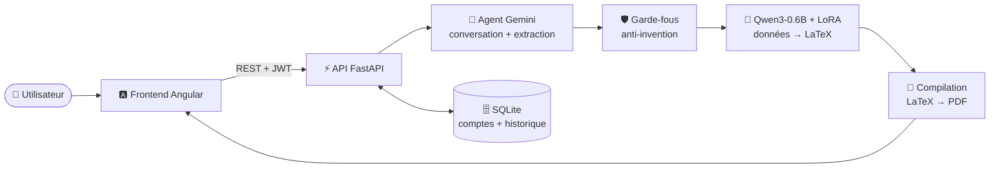

<div align="center">

# 📄 CV Studio

### Crée un CV professionnel en discutant avec une IA

Raconte ton parcours avec tes mots : l'assistant pose les bonnes questions, reformule tes expériences
sans rien inventer, puis génère un **CV PDF** élégant grâce à un **modèle fine-tuné**.

<br>


</div>

---

## ✨ Fonctionnalités

| | Fonctionnalité | Description |
|:-:|---|---|
| 💬 | **Conversation naturelle** | L'assistant comprend un texte en vrac, pose des questions et répond aux tiennes |
| ✍️ | **Descriptions professionnelles** | Tes stages et projets sont reformulés ; tu valides chaque proposition |
| 🛡️ | **Zéro information inventée** | Des garde-fous suppriment toute date, compétence ou entreprise jamais donnée |
| 🤖 | **Modèle fine-tuné** | Qwen3-0.6B entraîné avec LoRA transforme tes données en LaTeX |
| 📑 | **CV en PDF** | Aperçu direct dans la discussion et téléchargement en un clic |
| 🔐 | **Comptes sécurisés** | Inscription, connexion (JWT), mots de passe hachés |
| 🗂️ | **Historique** | Tous tes CV générés, consultables et supprimables |

---

## 🏗️ Architecture



1. **Gemini** mène la conversation et met à jour les données du CV (sortie JSON imposée).
2. Les **garde-fous Python** retirent tout ce que l'utilisateur n'a jamais dit.
3. Le **modèle fine-tuné** écrit le corps LaTeX du CV ; Python ajoute le style.
4. Le LaTeX est **compilé en PDF** et enregistré dans l'**historique** de l'utilisateur.

---

## 🚀 Lancer le projet

### Prérequis

| Outil | Version | Lien |
|---|---|---|
|  | 3.11 ou plus | [python.org](https://www.python.org/downloads/) |
|  | 20 ou plus | [nodejs.org](https://nodejs.org/) |
|  | gratuite | [aistudio.google.com/apikey](https://aistudio.google.com/apikey) |
|  | 4 Go (conseillé) | sinon le modèle tourne sur CPU, plus lentement |

### 1️⃣ Cloner le dépôt

```bash
git clone https://github.com/BrahimGarram/AI-CV-Generator.git
cd AI-CV-Generator
```

### 2️⃣ Installer le backend

```bash
python -m venv .venv

# Windows
.venv\Scripts\activate
# macOS / Linux
source .venv/bin/activate

# PyTorch avec CUDA (GPU NVIDIA) — sinon : pip install torch
pip install torch --index-url https://download.pytorch.org/whl/cu126

pip install -r requirement.txt
```

### 3️⃣ Configurer la clé API

Crée un fichier **`.env`** à la racine du projet (il n'est jamais envoyé sur GitHub) :

```env
GEMINI_API_KEY=ta_cle_gemini
GEMINI_MODEL=gemini-3.5-flash
GEMINI_FALLBACK_MODELS=gemini-3.1-flash-lite,gemini-2.5-flash
LLM_PROVIDER=gemini
```

### 4️⃣ Démarrer l'API

```bash
python -m uvicorn app.api:app --port 8000
```

> 📘 Documentation interactive de l'API : **http://localhost:8000/docs**

### 5️⃣ Démarrer le frontend

Dans un **second terminal** :

```bash
cd frontend
npm install
npm start
```

> 🌐 Ouvre **http://localhost:4200**, crée ton compte et commence ton CV !

---

## 🧠 Le modèle fine-tuné

Le modèle entraîné est déjà fourni dans `output/cv-latex-lora/`. Pour le réentraîner :

```bash
python build_dataset.py      # génère le dataset (900 exemples + 60 de validation)
python train.py              # fine-tuning LoRA (~45 min sur un GPU de 4 Go)
python evaluate.py           # mesure la qualité sur le jeu de validation
```

<details>
<summary><b>📊 Détails de l'entraînement</b></summary>

<br>

| Paramètre | Valeur |
|---|---|
| Modèle de base | Qwen3-0.6B (bf16) |
| Méthode | SFT + **LoRA** (r = 16, α = 32), loss sur la réponse uniquement |
| Couches ciblées | q, k, v, o, gate, up, down |
| Paramètres entraînés | 10,1 M (1,67 %) |
| Dataset | 900 exemples d'entraînement, 60 de validation (descriptions jamais vues) |
| Meilleure loss de validation | **0,087** |
| LaTeX valide sur la validation | **100 %** (30 / 30) |

**Pourquoi LoRA et pas QLoRA ?** Le modèle de 0,6 milliard de paramètres tient déjà en bf16 sur 4 Go :
la quantification 4 bits de QLoRA n'apportait aucun gain et aurait dégradé un petit modèle.

</details>

---

## 🔌 API

| Méthode | Route | Description |
|:-:|---|---|
|  | `/auth/register` | Créer un compte |
|  | `/auth/login` | Se connecter (renvoie un jeton JWT) |
|  | `/auth/me` | Profil de l'utilisateur connecté |
|  | `/sessions` | Démarrer une conversation |
|  | `/sessions/{id}/messages` | Envoyer un message (génère le CV sur demande) |
|  | `/sessions/{id}/generate` | Forcer la génération du CV |
|  | `/history` | Liste des CV générés |
|  | `/history/{id}/pdf` | Télécharger un CV en PDF |
|  | `/history/{id}` | Supprimer un CV |

---

## 📁 Structure du projet

```
AI-CV-Generator/
├── app/
│   ├── api.py              # API FastAPI (comptes, conversation, historique)
│   └── main.py             # version en ligne de commande
├── frontend/               # application Angular 20
│   └── src/app/pages/      # accueil, connexion, inscription, espace personnel
├── agent.py                # agent conversationnel (prompt système + JSON)
├── llm.py                  # appel à Gemini (ou Ollama) avec modèles de secours
├── guards.py               # garde-fous anti-invention
├── generator.py            # génération du CV avec le modèle fine-tuné
├── latex.py                # format LaTeX, validation, rendu de secours
├── latex_compiler.py       # conversion LaTeX -> PDF
├── auth.py · db.py         # authentification JWT et base SQLite
├── build_dataset.py        # création du dataset
├── dataset_pools.py        # données sources du dataset
├── train.py · evaluate.py  # entraînement LoRA et évaluation
├── dataset/                # dataset d'entraînement et de validation
└── output/cv-latex-lora/   # modèle fine-tuné (adaptateur LoRA)
```

---

## 🔒 Confidentialité

- Les mots de passe sont **hachés** (PBKDF2-SHA256), jamais stockés en clair.
- Chaque utilisateur n'accède **qu'à ses propres CV**.
- La clé API (`.env`), la base de données et les CV des utilisateurs (`data/`) **ne sont jamais versionnés**.
- Sans moteur LaTeX local (MiKTeX, TeX Live), le PDF est compilé par le service en ligne
  [texlive.net](https://texlive.net) ; mets `LATEX_ONLINE=false` dans `.env` pour le désactiver.

---

<div align="center">

Réalisé par **[Brahim Garram](https://github.com/BrahimGarram)**

</div>
